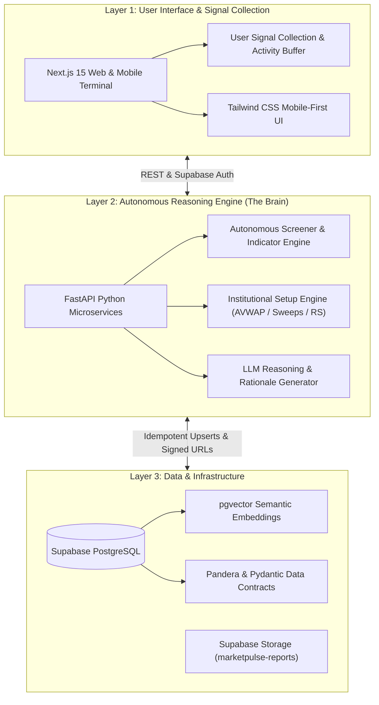

# MarketPulse (Tripzy.travel)

[](https://github.com/tripzydevops/stock-report/actions/workflows/ci.yml)
[](https://github.com/tripzydevops/stock-report/actions/workflows/market_pulse_cron.yml)
[](https://supabase.com)
[](https://fastapi.tiangolo.com)
[](https://nextjs.org)
[](https://pandera.readthedocs.io)

**MarketPulse** is an institutional-grade, autonomous market intelligence, technical screening, and portfolio analysis platform designed for **Borsa Istanbul (BIST)** and **US Equities / ETFs**. 

Built with a 3-layer autonomous agent architecture, MarketPulse generates deterministic, immutable historical reports, captures point-in-time price snapshots, evaluates multi-horizon trading strategies, and provides real-time portfolio tracking with multi-tenant row-level security.

---

## 🏛️ System Architecture

MarketPulse strictly adheres to a **3-Layer Architecture**:



---

## ✨ Core Features

### 1. Institutional Screening Algorithms
MarketPulse runs 7 automated screening engines:
- **Anchored VWAP Bounce:** Identifies high-volume structural retests of swing lows/highs.
- **Liquidity Sweep & Reclaim:** Detects stop hunts below key support followed by swift intraday reclaim.
- **Relative Strength Leader:** Flags assets outperforming the BIST 100 benchmark during market pullbacks.
- **50 EMA Pullback in Uptrend:** Trend-following entries in established bull trends.
- **Volatility Breakout:** 20-day high breakout with $\ge 2\times$ 20-day volume surge.
- **Volatility Squeeze:** Bollinger Bands contraction inside Keltner Channels.
- **Mean Reversion:** Extreme oversold RSI ($< 30$) with bullish reversal candle.

### 2. Immutable Report Archive & Storage
- Generates comprehensive multi-tab Excel reports (`MarketPulse_{YYYY-MM-DDTHH-mm-ss-fff}.xlsx`).
- Uploads directly to private Supabase Storage (`marketpulse-reports`) with **`upsert: false`** guaranteeing strict immutability.
- Pre-upload quality gates enforce SHA-256 checksums, non-zero file size, workbook health, and minimum row counts.
- Maintains an atomic `report_files` registry with short-lived presigned download URLs.

### 3. Safe, Non-Destructive Signal Lifecycle
- Open trade signals are keyed by composite `(asset_id, strategy)`, allowing multiple concurrent setups per asset.
- **Held Stock Protection:** Open positions in active portfolios are never auto-archived or closed.
- **Zero Deletion:** Unowned expired or stopped signals transition to `stopped_out` or `target_hit` in the audit ledger without deleting active setups.

### 4. Dynamic Cash Ledger & Portfolio Lab
- Strictly calculates available cash from transaction history:
  $$\text{Cash Balance} = \sum \text{Deposits} + \sum \text{Sells} - \sum \text{Buys} - \sum \text{Withdrawals}$$
- Multi-currency portfolio tracking (`TRY` / `USD`) with live FX rates.
- Forward dividend income projection, ex-dividend calendars, and DCA tranche optimization.

### 5. Institutional Backtesting & Strategy Simulation Engine
Located in [`backend/app/services/backtesting_engine.py`](./backend/app/services/backtesting_engine.py):
- **Execution Frictions:** Simulates broker commissions (e.g., 10 bps / 0.10%) and slippage (e.g., 5 bps / 0.05%) on entries and exits.
- **Position Sizing & Cash Management:** Fixed fractional risk budgeting (1-2% account equity risked per trade) with strict cash ceilings and max open position caps (`max_open_positions=10`).
- **Risk-Adjusted Performance Metrics:**
  - **Sharpe Ratio** (Annualized, 252 days against risk-free benchmark rate).
  - **Sortino Ratio** (Downside volatility penalization).
  - **Calmar Ratio** (CAGR / Peak-to-Trough Max Drawdown).
  - **Equity Curves & Peak-to-Trough Drawdown Curves**.
  - **Trade Expectancy, Win Rates, & Strategy P&L Attribution**.

### 6. Candlestick Patterns & Advanced Institutional Indicators
- **Vectorized Candlestick Engine ([`backend/app/services/candlestick_patterns.py`](./backend/app/services/candlestick_patterns.py)):**
  - Ultra-fast NumPy/Pandas pattern recognition fully compatible with Python 3.14+.
  - Detects **Bullish Engulfing**, **Bearish Engulfing**, **Hammer**, **Inverted Hammer**, **Morning Star**, **Evening Star**, and **Doji**.
- **Institutional Indicators ([`backend/app/services/indicators.py`](./backend/app/services/indicators.py)):**
  - **SuperTrend:** Dynamic ATR band ratcheting (+1 for Bullish, -1 for Bearish regime).
  - **Chaikin Money Flow (CMF 20):** Institutional accumulation/distribution oscillator bounded $[-1.0, +1.0]$.
  - **Volume Weighted Average Price (VWAP):** Institutional benchmark pricing.

### 7. Interactive Lightweight Charts on Next.js
Located in [`frontend/src/components/InteractiveCanvasChart.tsx`](./frontend/src/components/InteractiveCanvasChart.tsx):
- High-performance TradingView Canvas rendering (`lightweight-charts ^5.2.1`).
- **EMA Overlays:** Dynamic calculation and toggle switches for **EMA 20** (amber), **EMA 50** (cyan), and **EMA 200** (pink).
- **Bollinger Bands:** 20-period 2.0σ dashed overlay toggle.
- **Strategy Triggers:** Distinct price lines for Entry, Target, and Stop Loss.
- **Timeframe Zoom Controls:** Interactive range buttons (`1M`, `3M`, `6M`, `1Y`, `ALL`).
- **Real-Time Crosshair HUD:** High-precision Open, High, Low, Close, % Change, and Volume formatting.

### 8. Pandera Data Contracts & Schema Validation
Located in [`backend/app/models/data_contracts.py`](./backend/app/models/data_contracts.py):
- **OHLCV Integrity:** Guarantees $P > 0$, $\text{High} \ge \text{Low}$, $\text{High} \ge \text{Open/Close}$, $\text{Low} \le \text{Open/Close}$, and $\text{Volume} \ge 0$.
- **Indicator Boundaries:** Enforces $0 \le \text{RSI}_{14} \le 100$ and $\text{BB Upper} \ge \text{Lower}$.
- **Spot Trade Setup Sanity:** Rejects inverted long trades where $\text{Target} \le \text{Entry}$ or $\text{Stop} \ge \text{Entry}$.
- **Automatic Sanitization:** Drops corrupt split/tick anomalies before database persistence without crashing batch pipelines.

### 9. Supabase Migration Linter & Quality Gates
Located in [`scripts/validate_migrations.py`](./scripts/validate_migrations.py):
- Enforces strict timestamped naming convention (`YYYYMMDDHHMMSS_<name>.sql`).
- Guards against destructive commands (`DROP SCHEMA public`, unchecked `TRUNCATE TABLE`).
- Validates delimiter pairing and UTF-8 encoding across all migration files.
- Automated as a dedicated GitHub Actions CI quality gate.

### 10. Multi-Platform Responsiveness & Playwright E2E Verification
Full end-to-end testing across both Desktop and Mobile devices using Playwright:
- **Desktop Chrome (1440x900):** Collapsible sidebar, multi-column analytics, interactive charts, and zero horizontal overflow.
- **Mobile Devices (Pixel 7 & iPhone 14):** 1-tap `MobileBottomNav`, off-canvas slideover drawer, prominent header sync buttons, and touch-optimized date filters.
- **Automated Verification:** 17 comprehensive Playwright tests passing across Desktop and Mobile emulators.

---

## 🗄️ Database Schema & Supabase

All database tables include Row-Level Security (RLS) policies:

| Table | Description | Conflict Key |
| :--- | :--- | :--- |
| `assets` | Registry of BIST & US stocks, ETFs, and indices | `symbol` |
| `price_history` | Historical daily OHLCV bars | `asset_id,date` |
| `daily_indicators` | Computed indicators (EMA, RSI, ATR, MACD, BB, KC) | `asset_id,date` |
| `price_snapshots` | Intraday point-in-time price captures tied to reports | `asset_id,snapshot_time` |
| `stock_movements` | Granular price changes with indicator metadata | `asset_id,movement_time` |
| `trade_signals` | Open and resolved strategy signals with AI rationale | `id` (managed lifecycle) |
| `report_files` | Registry of immutable Excel reports in Supabase Storage | `storage_path` |
| `opening_direction` | 15-minute Opening Range Breakout (ORB) gap bias | `id` |
| `market_catalysts` | KAP company disclosures & macroeconomic news | `id` |
| `portfolio_positions`| Multi-tenant active holdings scoped by `user_id` | `id` |
| `portfolio_orders` | User trade execution history | `id` |
| `portfolio_transfers` | Cash deposits and withdrawals | `id` |

Migrations are located in [`supabase/migrations/`](./supabase/migrations/) and mirrored in [`database/schema.sql`](./database/schema.sql).

---

## 🛠️ Tech Stack & Requirements

- **Backend:** Python 3.11+, FastAPI, Pandas, Pandera, NumPy, OpenPyXL, YFinance, Pytest.
- **Frontend:** Next.js 15 (App Router), React 19, TypeScript, Tailwind CSS, Lucide Icons.
- **Cloud & Database:** Supabase PostgreSQL, Supabase Storage, Supabase Auth.
- **CI/CD:** GitHub Actions (Automated Pytest, TypeScript typecheck, Next.js build, and scheduled sync).

---

## 🚀 Quickstart & Setup

### 1. Clone & Environment Setup
```bash
git clone https://github.com/tripzydevops/stock-report.git
cd stock-report
```

Copy the environment templates:
```bash
cp .env.example .env
cp backend/.env.example backend/.env
```

Set your Supabase credentials in `.env`:
```env
SUPABASE_URL=https://your-project.supabase.co
SUPABASE_KEY=your-anon-key
SUPABASE_SERVICE_KEY=your-service-role-key
GEMINI_API_KEY=your-gemini-api-key
```

### 2. Backend Setup
```bash
cd backend
python -m venv .venv
# On Windows:
.venv\Scripts\activate
# On Linux/macOS:
source .venv/bin/activate

pip install -r requirements.txt
```

Run tests:
```bash
pytest tests -v
```

Run FastAPI server:
```bash
uvicorn app.main:app --reload --port 8000
```

### 3. Frontend Setup
```bash
cd ../frontend
npm install
npm run dev
```
Open [http://localhost:3000](http://localhost:3000) in your browser.

### 4. Running the Daily MarketPulse Pipeline
To generate an immutable report and sync all data to Supabase:
```bash
# From repository root:
python export_to_spreadsheet.py
```

---

## 🤖 Antigravity Workspace Skills

This repository includes official reusable **Antigravity Skills** in [`.agents/skills/`](./.agents/skills/):
- **[`market-data-ingestion`](./.agents/skills/market-data-ingestion/SKILL.md):** OHLCV ingestion, symbol sanitization (`.IS`), and BIST taban circuit-breaker rules.
- **[`supabase-migration`](./.agents/skills/supabase-migration/SKILL.md):** Timestamped SQL migration standards and RLS policies.
- **[`report-storage`](./.agents/skills/report-storage/SKILL.md):** Sub-second path generation, validation gates, and immutable storage uploads.
- **[`idempotent-sync`](./.agents/skills/idempotent-sync/SKILL.md):** Conflict keys, chunking, and non-destructive signal reconciliation.
- **[`backtesting`](./.agents/skills/backtesting/SKILL.md):** Realistic trade friction (BIST commission + BSMV), slippage, and out-of-sample testing.
- **[`frontend-data`](./.agents/skills/frontend-data/SKILL.md):** Typed API client standards, dynamic cash ledger math, and model portfolio cold start.

---

## 🔄 CI/CD & Automated Pipelines

- **CI Workflow (`.github/workflows/ci.yml`):** Runs on every push and pull request to `main`. Executes backend unit tests (`pytest`), frontend TypeScript typecheck (`npx tsc --noEmit`), and production build (`npm run build`).
- **Daily Market Sync (`.github/workflows/market_pulse_cron.yml`):** Automated cron execution scheduled 4 times daily to capture opening gaps, midday trends, and end-of-day market wraps.

---

## 📄 License
Private & Proprietary. Developed for Tripzy.travel / MarketPulse.
