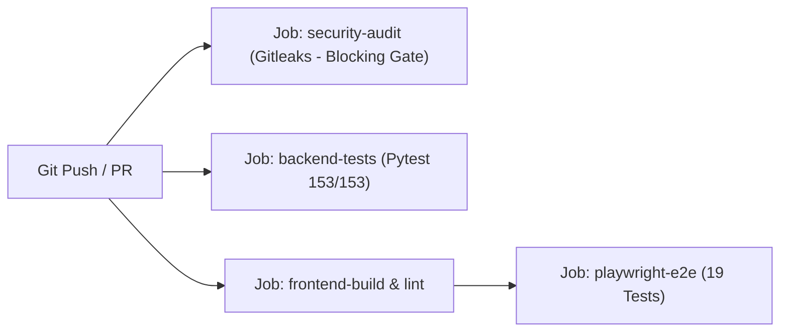

# MarketPulse: Security, Authorization & Multi-Tenant RLS Architecture

**Platform:** MarketPulse (Tripzy.travel)  
**Author:** Lead System Architect & Senior Developer  
**Status:** In Production  
**Last Updated:** November 2026  
**Related Guides:** [SYSTEM_ARCHITECTURE_AND_USER_GUIDE.md](file:///C:/Users/elif/.gemini/antigravity/scratch/market-pulse/docs/SYSTEM_ARCHITECTURE_AND_USER_GUIDE.md) | [LIVE_DIVIDEND_AND_PRICING_PIPELINE.md](file:///C:/Users/elif/.gemini/antigravity/scratch/market-pulse/docs/LIVE_DIVIDEND_AND_PRICING_PIPELINE.md)

---

## 1. Executive Summary & Security Threat Modeling

MarketPulse operates an institutional market intelligence, screening, and portfolio optimization engine built on Next.js 16 (frontend), FastAPI (backend), and Supabase PostgreSQL.

Prior to hardening, an external architectural audit identified key security vulnerabilities:
1. **Permissive Row Level Security (P1):** The portfolio tables (`portfolio_positions`, `portfolio_orders`, `portfolio_transfers`) possessed default `"Allow all"` policies (`qual = true`), allowing any unauthenticated client with the public anon key to mutate or truncate institutional Model Portfolio records (`user_id IS NULL`).
2. **Ungated Frontend Mutations (P1):** Demo/guest interactions attempted direct Supabase database mutations with `user_id = null`, risking unintended row collisions and state corruption.
3. **Absence of Automated Secret Scanning in CI (P0/P2):** Workflows lacked automated static git analysis for leaked private credentials, API tokens, and service-role keys.

This document details the remediations implemented across Supabase database policies, frontend state isolation, CI pipeline integration, and automated Playwright/Pytest test suites.

---

## 2. Supabase PostgreSQL Multi-Tenant RLS Policy Matrix

All portfolio and watchlist entities enforce strict PostgreSQL Row Level Security (`ALTER TABLE ... ENABLE ROW LEVEL SECURITY`). Policies explicitly partition institutional **Model Portfolio** records from authenticated **Private Portfolios**.

### 2.1 Policy Invariants
* **Model Portfolio (`user_id IS NULL`):**
  * Globally readable by all visitors (unauthenticated/anon and authenticated users).
  * **Strictly immutable** for anon clients: zero `INSERT`, `UPDATE`, or `DELETE` permissions.
  * Mutated only via administrative backend microservices utilizing `SUPABASE_SERVICE_ROLE_KEY`.
* **Private User Portfolios (`user_id IS NOT NULL`):**
  * Multi-tenant isolation: accessible solely by the owning identity (`auth.uid() = user_id`).
  * Full CRUD authorized for `auth.uid() = user_id`.
  * Cross-tenant data leakage is structurally impossible at the database engine level.

### 2.2 Table Policy Enforcement Specification

| Table | Policy Name | Command | Expression / Check | Target Role |
| :--- | :--- | :---: | :--- | :--- |
| `portfolio_positions` | `Positions SELECT` | `SELECT` | `(user_id IS NULL) OR (auth.uid() = user_id)` | `anon`, `authenticated` |
| `portfolio_positions` | `Positions INSERT` | `INSERT` | `auth.uid() IS NOT NULL AND auth.uid() = user_id` | `authenticated` |
| `portfolio_positions` | `Positions UPDATE` | `UPDATE` | `auth.uid() IS NOT NULL AND auth.uid() = user_id` | `authenticated` |
| `portfolio_positions` | `Positions DELETE` | `DELETE` | `auth.uid() IS NOT NULL AND auth.uid() = user_id` | `authenticated` |
| `portfolio_orders` | `Orders SELECT` | `SELECT` | `(user_id IS NULL) OR (auth.uid() = user_id)` | `anon`, `authenticated` |
| `portfolio_orders` | `Orders INSERT` | `INSERT` | `auth.uid() IS NOT NULL AND auth.uid() = user_id` | `authenticated` |
| `portfolio_orders` | `Orders UPDATE` | `UPDATE` | `auth.uid() IS NOT NULL AND auth.uid() = user_id` | `authenticated` |
| `portfolio_orders` | `Orders DELETE` | `DELETE` | `auth.uid() IS NOT NULL AND auth.uid() = user_id` | `authenticated` |
| `portfolio_transfers` | `Transfers SELECT` | `SELECT` | `(user_id IS NULL) OR (auth.uid() = user_id)` | `anon`, `authenticated` |
| `portfolio_transfers` | `Transfers INSERT` | `INSERT` | `auth.uid() IS NOT NULL AND auth.uid() = user_id` | `authenticated` |
| `portfolio_transfers` | `Transfers UPDATE` | `UPDATE` | `auth.uid() IS NOT NULL AND auth.uid() = user_id` | `authenticated` |
| `portfolio_transfers` | `Transfers DELETE` | `DELETE` | `auth.uid() IS NOT NULL AND auth.uid() = user_id` | `authenticated` |
| `watchlist_items` | `Watchlist Items Select` | `SELECT` | `auth.uid() IS NOT NULL AND user_id = auth.uid()::text` | `authenticated` |
| `watchlist_items` | `Watchlist Items Insert` | `INSERT` | `auth.uid() IS NOT NULL AND user_id = auth.uid()::text` | `authenticated` |
| `watchlist_items` | `Watchlist Items Update` | `UPDATE` | `auth.uid() IS NOT NULL AND user_id = auth.uid()::text` | `authenticated` |
| `watchlist_items` | `Watchlist Items Delete` | `DELETE` | `auth.uid() IS NOT NULL AND user_id = auth.uid()::text` | `authenticated` |

*Migration Reference:* [`supabase/migrations/20261108102000_harden_portfolio_rls.sql`](file:///C:/Users/elif/.gemini/antigravity/scratch/market-pulse/supabase/migrations/20261108102000_harden_portfolio_rls.sql)

---

## 3. Client Key Separation & Frontend State Isolation

### 3.1 Key Isolation Architecture
* **`NEXT_PUBLIC_SUPABASE_ANON_KEY`:**
  * Publicly embedded in client web bundles.
  * Subject to database RLS policies on every query.
  * Never permitted to write unowned or system records.
* **`SUPABASE_SERVICE_ROLE_KEY`:**
  * Strictly private; restricted to server-side backend Python microservices (`backend/.env`).
  * Never exposed in client code, public GitHub repositories, or Next.js edge runtime.

### 3.2 Frontend Guest / Demo Isolation Pattern
In [`frontend/src/app/page.tsx`](file:///C:/Users/elif/.gemini/antigravity/scratch/market-pulse/frontend/src/app/page.tsx), all portfolio mutation handlers enforce an authentication and demo mode check before triggering database requests:

```typescript
// Example: Gated portfolio deletion handler
const handleRemoveHolding = async (symbol: string) => {
  // Update local UI state optimistically for instantaneous feedback
  setHoldings(prev => prev.filter(h => h.symbol !== symbol));

  // Gate Supabase persistence: Only authenticated non-demo accounts persist to DB
  if (user && !isDemoMode) {
    try {
      await supabase
        .from('portfolio_positions')
        .delete()
        .eq('user_id', user.id)
        .eq('symbol', symbol);
    } catch (err) {
      console.error('Failed to sync holding removal to Supabase:', err);
    }
  }
};
```

This pattern applies across:
- `handleRemoveHolding`
- `handleAddHolding`
- `handleBuyMoreHolding`
- `handleSellHolding`
- `handleAddTransfer`
- `handleUpdateStopLoss`
- `handleUpdateTargetPrice`
- `handleToggleStrategyType`

**Outcome:** Unauthenticated visitors experimenting with portfolio features enjoy smooth, local interactive state without generating unowned database records or encountering silent RLS error drops.

### 3.3 Centralized Server-Side Supabase Client (`supabaseServer.ts`)
To eliminate duplicate client instantiations and enforce uniform key separation across all Next.js App Router route handlers, server clients are centralized in [`frontend/src/lib/supabaseServer.ts`](file:///C:/Users/elif/.gemini/antigravity/scratch/market-pulse/frontend/src/lib/supabaseServer.ts):

* **`getServerSupabase()`**: Instantiates a standard server-side client utilizing `NEXT_PUBLIC_SUPABASE_ANON_KEY`. All queries are strictly subjected to PostgreSQL Row Level Security (RLS). Used across standard read/write APIs (`/api/assets`, `/api/dividends`, `/api/movements`, `/api/quant/*`, `/api/watchlist`).
* **`getAdminSupabase()`**: Instantiates an administrative client using `SUPABASE_SERVICE_ROLE_KEY`. This key bypasses RLS and is restricted exclusively to authorized administrative tasks (generating signed storage URLs in `/api/reports`, and running scheduled syncs in `/api/sync`).
* **Zero Client-Side Imports in API Layer**: Verified with static grep (`git grep "supabaseClient" frontend/src/app/api/` returns 0). Client browser singletons are never imported into server route handlers.

### 3.4 Scheduled Sync & Cron Authorization Gate
The background sync endpoint ([`/api/sync`](file:///C:/Users/elif/.gemini/antigravity/scratch/market-pulse/frontend/src/app/api/sync/route.ts)) executes daily market data ingestion and updates asset prices. To prevent unauthorized execution or resource exhaustion attacks by public crawlers:

* **`verifyCronAuthorization(request)`**: Validates either `Authorization: Bearer <CRON_SECRET>` or the custom `x-cron-secret: <CRON_SECRET>` header against the server environment variable.
* **Fail-Closed Protection**: In production (`NODE_ENV === 'production'`), requests lacking a valid secret are immediately rejected with HTTP 401 Unauthorized.
* **Safe Data Contracts**: Removed all synthetic fallback prices and fake volume numbers (`100000`). If a market quote is unavailable, fields remain clean `null`, preserving data integrity.

### 3.5 Request-Scoped Authenticated Server Client (`getAuthenticatedSupabase`)
For user-authenticated API endpoints (e.g. `/api/watchlist`), standard unauthenticated or anonymous server clients fail RLS evaluation because Supabase's `auth.uid()` evaluates to `null`. 
To preserve user identity across Next.js API route handlers without compromising RLS:

* **Token Extraction:** `getAuthenticatedSupabase(request)` inspects incoming HTTP request headers for an `Authorization: Bearer <token>` header or Supabase auth session cookies (`sb-<project-ref>-auth-token`).
* **Header Forwarding:** If an access token is detected, it is forwarded in the Supabase client options via `global: { headers: { Authorization: `Bearer ${token}` } }`.
* **Identity Verification:** The route handler calls `await authSupabase.auth.getUser()`. If a valid user is resolved, all downstream queries and mutations evaluate with `auth.uid() = user.id`.
* **Safe Guest Fallback:** If the visitor is unauthenticated, the route handler immediately short-circuits with `{ data: [], guest: true }` without triggering unauthenticated DB queries that would violate PostgreSQL RLS.

### 3.6 Guest Watchlist Synchronization & LocalStorage Unification
To prevent inconsistency between the dedicated Watchlist tab and inline card star toggles:
* **Dual-Key Sync:** Both `marketpulse_guest_watchlist` (`WatchlistItemData[]`) and `marketpulse_guest_starred_tickers` (`string[]`) are updated atomically in [`TradeCard.tsx`](file:///C:/Users/elif/.gemini/antigravity/scratch/market-pulse/frontend/src/components/TradeCard.tsx).
* **Authenticated Authorization Headers:** When a user is signed in, client-side requests to `/api/watchlist` attach `Authorization: Bearer <access_token>` from the active Supabase session.

### 3.7 Price Ingestion Provenance & Forward Database Migration
To guarantee strict auditability and eliminate fallback date assumptions:
* **Forward Migration:** Added `source VARCHAR(50)` and `observed_at TIMESTAMPTZ` columns to `public.price_history` via [`20261108220000_forward_hardening_rls_and_price_metadata.sql`](file:///C:/Users/elif/.gemini/antigravity/scratch/market-pulse/supabase/migrations/20261108220000_forward_hardening_rls_and_price_metadata.sql) with an index on `source`.
* **Zero Date Guessing:** In `fetchLiveQuote` and `parseTefasDate` ([`frontend/src/app/api/assets/route.ts`](file:///C:/Users/elif/.gemini/antigravity/scratch/market-pulse/frontend/src/app/api/assets/route.ts)), if the upstream provider does not deliver a verifiable timestamp, `observedAt` and `sessionDate` return `null`. The system never silently substitutes `today`.
* **Provenance Tracking:** Ingested price rows explicitly store `source` (e.g. `yahoo_finance`, `tefas`) and `observed_at` to establish data provenance.

---

## 4. Continuous Integration & Security Automation

The GitHub Actions CI pipeline ([`.github/workflows/ci.yml`](file:///C:/Users/elif/.gemini/antigravity/scratch/market-pulse/.github/workflows/ci.yml)) incorporates automated, non-bypassable security gating:



1. **Gitleaks Secret Scanning (Enforced Blocking Gate):**
   * Runs `gitleaks/gitleaks-action@v2` across full git commit history (`fetch-depth: 0`).
   * Operates without `continue-on-error`, strictly failing and blocking PRs or commits that introduce API tokens, service-role keys, or private certificates.
2. **Playwright Security & Authorization Verification:**
   * Automated verification suite ([`frontend/tests/security-and-rls.spec.ts`](file:///C:/Users/elif/.gemini/antigravity/scratch/market-pulse/frontend/tests/security-and-rls.spec.ts)) runs against the live Supabase client using the anon key.
   * Completely **non-destructive**: uses dedicated fixture UUIDs (`ffffffff-ffff-ffff-ffff-ffffffffffff`), asserting count preservation and zero unauthorized mutation or deletion.
   * Proves that attempts to insert, update, or delete model portfolio rows, private portfolios, or watchlist items fail with PostgreSQL RLS policy violation errors.
3. **Multi-Viewport Responsive Matrix Verification:**
   * Automated verification suite ([`frontend/tests/responsive-matrix.spec.ts`](file:///C:/Users/elif/.gemini/antigravity/scratch/market-pulse/frontend/tests/responsive-matrix.spec.ts)) verifies layout stability across 4 critical form factors:
     * Small Mobile (`360x740`)
     * Standard iPhone (`390x844`)
     * Tablet Portrait (`768x1024`)
     * Small Laptop / Tablet Landscape (`1024x768`)
   * Asserts `document.documentElement.scrollWidth <= window.innerWidth` across core views (Signals, Dividends, Portfolio) to eliminate horizontal overflow.

---

## 5. Verification & Test Ledger

All automated test suites execute cleanly:

### 5.1 Playwright E2E & RLS Test Suite (`19/19 Passed`)
* `security-and-rls.spec.ts`:
  1. `[PASS]` Model Portfolio (`user_id IS NULL`) is readable by public anon client.
  2. `[PASS]` RLS blocks unauthenticated/anon clients from inserting unowned positions (`violates row-level security policy`).
  3. `[PASS]` RLS blocks unauthenticated/anon clients from inserting unowned orders.
  4. `[PASS]` RLS blocks unauthenticated/anon clients from inserting unowned cash transfers.
  5. `[PASS]` Non-destructive verification: RLS blocks anon mutation or deletion of Model Portfolio.
  6. `[PASS]` RLS blocks unauthenticated/guest clients from inserting into `watchlist_items` table.
  7. `[PASS]` Multi-tenant privacy: anon clients cannot view private user watchlist items or positions.
* `dividend-and-prices.spec.ts`:
  1. `[PASS]` Dividends API returns verified multi-year dividend events and market summary.
  2. `[PASS]` Asset Catalog API returns 100% valid prices with zero 100.00 fallbacks.
  3. `[PASS]` Frontend Dividend Tab renders live yields, schedules, and handles market scope toggle.
  4. `[PASS]` Asset Catalog API preserves market filter across page boundaries (`limit=2000`).
* `desktop-view.spec.ts`:
  1. `[PASS]` Desktop layout loads with full expanded sidebar and no horizontal overflow.
  2. `[PASS]` Navigation across core tabs functions cleanly on Desktop.
  3. `[PASS]` Date filter bar toggles without layout shift on Desktop.
  4. `[PASS]` TURSG tranche matching restores Lot #1 to 167 shares and shows closed scalp section.
* `responsive-matrix.spec.ts`:
  1. `[PASS]` Viewport Small Mobile (`360px` [360x740]) renders cleanly without horizontal overflow.
  2. `[PASS]` Viewport Standard iPhone (`390px` [390x844]) renders cleanly without horizontal overflow.
  3. `[PASS]` Viewport Tablet Portrait (`768px` [768x1024]) renders cleanly without horizontal overflow.
  4. `[PASS]` Viewport Small Laptop / Tablet Landscape (`1024px` [1024x768]) renders cleanly without horizontal overflow.

### 5.2 Backend Pytest Suite (`155/155 Passed`)
* 155 tests across algorithmic screeners, AVWAP calculations, post-exit recovery tracking (concurrency-safe), end-to-end verified trade lifecycle journeys (`test_complete_journey.py`), assistant LLM agents, and Supabase data synchronization pass with 0 errors.

### 5.3 Database Migration Linter (`4/4 Valid`)
* Validated using `python scripts/validate_migrations.py`:
  1. `20260922141511_initial_core_schema.sql`
  2. `20261027000000_report_files_and_movements.sql`
  3. `20261108102000_harden_portfolio_rls.sql`
  4. `20261108220000_forward_hardening_rls_and_price_metadata.sql`
