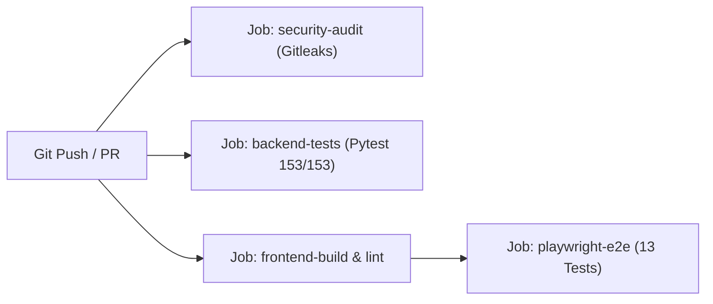

# MarketPulse: Security, Authorization & Multi-Tenant RLS Architecture

**Platform:** MarketPulse (Tripzy.travel)  
**Author:** Lead System Architect & Senior Developer  
**Status:** In Production  
**Last Updated:** November 2026  
**Related Guides:** [SYSTEM_ARCHITECTURE_AND_USER_GUIDE.md](file:///C:/Users/elif/.gemini/antigravity/scratch/market-pulse/docs/SYSTEM_ARCHITECTURE_AND_USER_GUIDE.md) | [LIVE_DIVIDEND_AND_PRICING_PIPELINE.md](file:///C:/Users/elif/.gemini/antigravity/scratch/market-pulse/docs/LIVE_DIVIDEND_AND_PRICING_PIPELINE.md)

---

## 1. Executive Summary & Security Threat Modeling

MarketPulse operates an institutional market intelligence, screening, and portfolio optimization engine built on Next.js 16 (frontend), FastAPI (backend), and Supabase PostgreSQL.

Prior to hardening, an external architectural audit identified key security vulnerabilities:
1. **Permissive Row Level Security (P1):** The portfolio tables (`portfolio_positions`, `portfolio_orders`, `portfolio_transfers`) possessed default `"Allow all"` policies (`qual = true`), allowing any unauthenticated client with the public anon key to mutate or truncate institutional Model Portfolio records (`user_id IS NULL`).
2. **Ungated Frontend Mutations (P1):** Demo/guest interactions attempted direct Supabase database mutations with `user_id = null`, risking unintended row collisions and state corruption.
3. **Absence of Automated Secret Scanning in CI (P0/P2):** Workflows lacked automated static git analysis for leaked private credentials, API tokens, and service-role keys.

This document details the remediations implemented across Supabase database policies, frontend state isolation, CI pipeline integration, and automated Playwright/Pytest test suites.

---

## 2. Supabase PostgreSQL Multi-Tenant RLS Policy Matrix

All portfolio and watchlist entities enforce strict PostgreSQL Row Level Security (`ALTER TABLE ... ENABLE ROW LEVEL SECURITY`). Policies explicitly partition institutional **Model Portfolio** records from authenticated **Private Portfolios**.

### 2.1 Policy Invariants
* **Model Portfolio (`user_id IS NULL`):**
  * Globally readable by all visitors (unauthenticated/anon and authenticated users).
  * **Strictly immutable** for anon clients: zero `INSERT`, `UPDATE`, or `DELETE` permissions.
  * Mutated only via administrative backend microservices utilizing `SUPABASE_SERVICE_ROLE_KEY`.
* **Private User Portfolios (`user_id IS NOT NULL`):**
  * Multi-tenant isolation: accessible solely by the owning identity (`auth.uid() = user_id`).
  * Full CRUD authorized for `auth.uid() = user_id`.
  * Cross-tenant data leakage is structurally impossible at the database engine level.

### 2.2 Table Policy Enforcement Specification

| Table | Policy Name | Command | Expression / Check | Target Role |
| :--- | :--- | :---: | :--- | :--- |
| `portfolio_positions` | `Positions SELECT` | `SELECT` | `(user_id IS NULL) OR (auth.uid() = user_id)` | `anon`, `authenticated` |
| `portfolio_positions` | `Positions INSERT` | `INSERT` | `auth.uid() IS NOT NULL AND auth.uid() = user_id` | `authenticated` |
| `portfolio_positions` | `Positions UPDATE` | `UPDATE` | `auth.uid() IS NOT NULL AND auth.uid() = user_id` | `authenticated` |
| `portfolio_positions` | `Positions DELETE` | `DELETE` | `auth.uid() IS NOT NULL AND auth.uid() = user_id` | `authenticated` |
| `portfolio_orders` | `Orders SELECT` | `SELECT` | `(user_id IS NULL) OR (auth.uid() = user_id)` | `anon`, `authenticated` |
| `portfolio_orders` | `Orders INSERT` | `INSERT` | `auth.uid() IS NOT NULL AND auth.uid() = user_id` | `authenticated` |
| `portfolio_orders` | `Orders UPDATE` | `UPDATE` | `auth.uid() IS NOT NULL AND auth.uid() = user_id` | `authenticated` |
| `portfolio_orders` | `Orders DELETE` | `DELETE` | `auth.uid() IS NOT NULL AND auth.uid() = user_id` | `authenticated` |
| `portfolio_transfers` | `Transfers SELECT` | `SELECT` | `(user_id IS NULL) OR (auth.uid() = user_id)` | `anon`, `authenticated` |
| `portfolio_transfers` | `Transfers INSERT` | `INSERT` | `auth.uid() IS NOT NULL AND auth.uid() = user_id` | `authenticated` |
| `portfolio_transfers` | `Transfers UPDATE` | `UPDATE` | `auth.uid() IS NOT NULL AND auth.uid() = user_id` | `authenticated` |
| `portfolio_transfers` | `Transfers DELETE` | `DELETE` | `auth.uid() IS NOT NULL AND auth.uid() = user_id` | `authenticated` |
| `watchlist_items` | `Watchlist Items Select` | `SELECT` | `(auth.uid() = user_id) OR (session_id LIKE 'guest_%')` | `anon`, `authenticated` |
| `watchlist_items` | `Watchlist Items Insert` | `INSERT` | `(auth.uid() = user_id) OR (session_id LIKE 'guest_%')` | `anon`, `authenticated` |
| `watchlist_items` | `Watchlist Items Delete` | `DELETE` | `(auth.uid() = user_id) OR (session_id LIKE 'guest_%')` | `anon`, `authenticated` |

*Migration Reference:* [`supabase/migrations/20261108102000_harden_portfolio_rls.sql`](file:///C:/Users/elif/.gemini/antigravity/scratch/market-pulse/supabase/migrations/20261108102000_harden_portfolio_rls.sql)

---

## 3. Client Key Separation & Frontend State Isolation

### 3.1 Key Isolation Architecture
* **`NEXT_PUBLIC_SUPABASE_ANON_KEY`:**
  * Publicly embedded in client web bundles.
  * Subject to database RLS policies on every query.
  * Never permitted to write unowned or system records.
* **`SUPABASE_SERVICE_ROLE_KEY`:**
  * Strictly private; restricted to server-side backend Python microservices (`backend/.env`).
  * Never exposed in client code, public GitHub repositories, or Next.js edge runtime.

### 3.2 Frontend Guest / Demo Isolation Pattern
In [`frontend/src/app/page.tsx`](file:///C:/Users/elif/.gemini/antigravity/scratch/market-pulse/frontend/src/app/page.tsx), all portfolio mutation handlers enforce an authentication and demo mode check before triggering database requests:

```typescript
// Example: Gated portfolio deletion handler
const handleRemoveHolding = async (symbol: string) => {
  // Update local UI state optimistically for instantaneous feedback
  setHoldings(prev => prev.filter(h => h.symbol !== symbol));

  // Gate Supabase persistence: Only authenticated non-demo accounts persist to DB
  if (user && !isDemoMode) {
    try {
      await supabase
        .from('portfolio_positions')
        .delete()
        .eq('user_id', user.id)
        .eq('symbol', symbol);
    } catch (err) {
      console.error('Failed to sync holding removal to Supabase:', err);
    }
  }
};
```

This pattern applies across:
- `handleRemoveHolding`
- `handleAddHolding`
- `handleBuyMoreHolding`
- `handleSellHolding`
- `handleAddTransfer`
- `handleUpdateStopLoss`
- `handleUpdateTargetPrice`
- `handleToggleStrategyType`

**Outcome:** Unauthenticated visitors experimenting with portfolio features enjoy smooth, local interactive state without generating unowned database records or encountering silent RLS error drops.

---

## 4. Continuous Integration & Security Automation

The GitHub Actions CI pipeline ([`.github/workflows/ci.yml`](file:///C:/Users/elif/.gemini/antigravity/scratch/market-pulse/.github/workflows/ci.yml)) incorporates automated security gating:



1. **Gitleaks Secret Scanning:**
   * Runs `gitleaks/gitleaks-action@v2` across full git commit history (`fetch-depth: 0`).
   * Blocks pull requests introducing private keys, API secrets, or service-role credentials.
2. **Playwright Security & Authorization Verification:**
   * Automated verification suite ([`frontend/tests/security-and-rls.spec.ts`](file:///C:/Users/elif/.gemini/antigravity/scratch/market-pulse/frontend/tests/security-and-rls.spec.ts)) runs against live Supabase client using the anon key.
   * Proves that attempts to insert, update, or delete model portfolio rows fail with PostgreSQL RLS policy violation errors.

---

## 5. Verification & Test Ledger

All automated test suites execute cleanly:

### 5.1 Playwright E2E & RLS Test Suite (`13/13 Passed`)
* `security-and-rls.spec.ts`:
  1. `[PASS]` Model Portfolio (`user_id IS NULL`) is readable by public anon client.
  2. `[PASS]` RLS blocks unauthenticated/anon clients from inserting unowned positions (`new row violates row-level security policy`).
  3. `[PASS]` RLS blocks unauthenticated/anon clients from inserting unowned orders.
  4. `[PASS]` RLS blocks unauthenticated/anon clients from inserting unowned cash transfers.
  5. `[PASS]` RLS protects Model Portfolio from deletion by anon clients.
* `dividend-and-prices.spec.ts`:
  1. `[PASS]` Dividends API returns verified multi-year dividend events and market summary.
  2. `[PASS]` Asset Catalog API returns 100% valid prices with zero 100.00 fallbacks.
  3. `[PASS]` Frontend Dividend Tab renders live yields, schedules, and handles market scope toggle.
  4. `[PASS]` Asset Catalog API preserves market filter across page boundaries (`limit=2000`).
* `desktop-view.spec.ts`:
  1. `[PASS]` Desktop layout loads with full expanded sidebar and no horizontal overflow.
  2. `[PASS]` Navigation across core tabs functions cleanly on Desktop.
  3. `[PASS]` Date filter bar toggles without layout shift on Desktop.
  4. `[PASS]` TURSG tranche matching restores Lot #1 to 167 shares and shows closed scalp section.

### 5.2 Backend Pytest Suite (`153/153 Passed`)
* 153 tests across algorithmic screeners, AVWAP calculations, post-exit recovery tracking, assistant LLM agents, and Supabase data synchronization pass with 0 errors.

### 5.3 Database Migration Linter (`3/3 Valid`)
* Validated using `python scripts/validate_migrations.py`:
  1. `20261031120000_recovery_tracking.sql`
  2. `20261107120000_live_dividends_and_prices.sql`
  3. `20261108102000_harden_portfolio_rls.sql`
