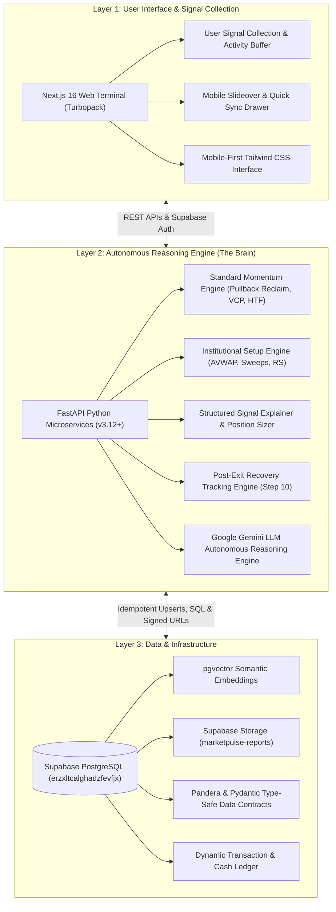
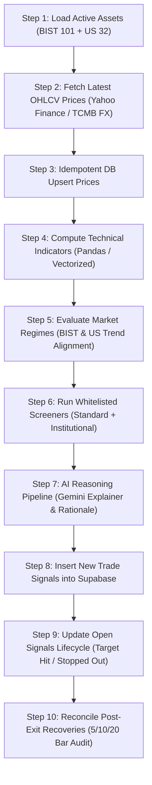

# MarketPulse: Master System Architecture & User Guide

**Platform:** MarketPulse (Tripzy.travel)  
**Author:** Lead System Architect & Senior Quantitative Developer  
**Status:** In Production (FastAPI Backend + Next.js 16 Frontend + Supabase PostgreSQL)  
**Last Updated:** November 2026  

---

## 1. Executive Summary & System Objective

**MarketPulse** is an institutional-grade, autonomous market intelligence, algorithmic screening, and multi-currency portfolio optimization platform engineered for **Borsa Istanbul (BIST)** and **US Equities / ETFs**.

### Core Mission: Eliminating the "Black Box" and Solving the Cold Start Problem
Traditional financial advisory tools and algorithmic screening software suffer from two major deficiencies:
1. **The Black Box Dilemma:** Machine-learning tools generate opaque signals without explaining the structural market mechanics. When market corrections strike, investors panic sell at bottoms or ignore stop-losses because they lack a thesis. MarketPulse eliminates the black box: every trade setup features an itemized quantitative trigger checklist (`Why It Fired`), an explicit thesis invalidation condition (`Invalidation Rule`), a multi-tier scale-out execution blueprint (`+1.25R` / `+2.25R`), and LLM-driven reasoning powered by Google Gemini.
2. **The Cold Start Problem:** For users without historical transaction records or in newly listed assets, MarketPulse applies cross-domain behavioral modeling, lifestyle risk profiling, and market microstructure decoupling to generate personalized, risk-budgeted allocations on day one.

---

## 2. Strict 3-Layer System Architecture

MarketPulse strictly adheres to a modular 3-Layer Architecture:



### Layer 1: User Interface & Signal Collection
- **Technologies:** Next.js 16.3.5, React 19, TypeScript, Tailwind CSS, Lucide icons, TradingView Lightweight Charts (`^5.2.1`).
- **Signal Collection Module:** Client-side activity buffer capturing user watchlists, portfolio adjustments, search queries, and risk preferences before asynchronously flushing to the backend.
- **Mobile-First Responsiveness:** Zero horizontal overflow across all smartphones (Pixel 7, iPhone 14/15/16). Features an off-canvas drawer, instant header sync, bottom navigation, and native modals.

### Layer 2: Autonomous Reasoning Engine (The "Brain")
- **Technologies:** Python 3.12+, FastAPI, NumPy, Pandas, Google Gemini API, Pytest.
- **Agent Orchestration:** Asynchronous microservices evaluating technical criteria, parsing corporate disclosures (KAP), sizing risk, and generating natural language blueprints.
- **Cross-Domain Inference:** When users lack trading history, the engine infers risk tolerance from capital allocations, dividend preference, and volatility sensitivity.

### Layer 3: Data & Infrastructure
- **Technologies:** Supabase PostgreSQL, `pgvector`, Pandera, Pydantic, Row-Level Security (RLS).
- **Relational Stores:** High-integrity tables for assets (1,303 active tickers), price history, corporate dividend events (`asset_dividends`), user portfolios, and cash transactions.
- **Analytical Views:** `v_latest_prices` (real-time quotes, technical indicators) and `v_dividend_summary` (713 dividend payers, trailing 12-month distributions, annualized yields).
- **Vector Store:** Embeddings for semantic search across company news, KAP filings, and financial statements.
- **Storage:** Private bucket (`marketpulse-reports`) with strict immutable report archiving (`upsert: false`).
- **Comprehensive Guide:** See [LIVE_DIVIDEND_AND_PRICING_PIPELINE.md](file:///C:/Users/elif/.gemini/antigravity/scratch/market-pulse/docs/LIVE_DIVIDEND_AND_PRICING_PIPELINE.md) for full pipeline specs.

---

## 3. All 9 Application Modules & Views

MarketPulse organizes institutional intelligence into 9 core views accessible via the desktop sidebar or mobile drawer:

| # | Tab / Route | Icon | Key Responsibilities |
| :---: | :--- | :---: | :--- |
| **1** | **Sinyaller & Fırsatlar** (`signals`) | 🎯 | Live algorithmic trade cards, multi-tier targets, accumulation badges, 1-click **Posizyon Hesapla** calculator modal, and the unified **💡 YZ Analiz & Planı** blueprint. |
| **2** | **Canlı Portföyüm** (`portfolio`) | 💼 | Multi-currency asset tracking (`TRY` / `USD`), live PnL, dynamic cash ledger, deposit/withdrawal ledger, distance to stop-loss, and 3-tranche DCA rebalancing. |
| **3** | **Temettü Gelirleri** (`dividend`) | 💰 | Live database dividend pipeline (11,076 verified corporate events across 713 assets), forward monthly/annual dividend cashflow calendar, payout safety scores, yield on cost (YoC), confirmed ex-dividend date tracker, and the conversational AI Dividend Advisor. |
| **4** | **Kartopu & Projeksiyon** (`forecast`) | 🔮 | DRIP (Dividend Reinvestment Plan) compounding simulator projecting exponential growth milestones over 5, 10, and 20 years with head-to-head asset comparisons. |
| **5** | **KAP Bildirimleri** (`catalysts`) | ⚡ | Real-time scraper capturing Public Disclosure Platform (KAP) company announcements, share buybacks (hisse geri alımları), new contract wins, and dividend votes. |
| **6** | **Kurumsal Quant Hub** (`quant`) | 🏛️ | Statistical Arbitrage pairs trading engine (Cointegration & Z-score spreads) and multi-factor quantitative ranking (Value, Quality, Momentum, Volatility). |
| **7** | **Strateji Karnesi** (`scorecard`) | 📈 | Public audit ledger containing 1,173+ historical trades, strategy win rates, profit factors, Sharpe ratios, and the newly added **Post-Exit Recovery Tracking** engine. |
| **8** | **Açılış Seansı (ORB)** (`orb`) | 🔔 | 15-minute Opening Range Breakout scanner tracking opening gap percentage and $\ge 1.5\times$ volume surges for morning trend continuation. |
| **9** | **Akademi & Bilgi Merkezi** (`help`) | 📖 | Searchable documentation hub, interactive strategy walkthroughs, 3-step beginner guide, and detailed FAQ accordion covering all mechanics. |

---

## 4. Algorithmic Trade-Finding Strategy Inventory

MarketPulse runs a decoupled, market-differentiated strategy whitelist. Every setup requires explicit mathematical confirmation:

```
Total Active Strategies: 12 Screening Engines + 1 Lifecycle Recovery Auditor
```

### 1. Trend Pullback Reclaim (Top Universal Engine)
- **Market:** Active on both **BIST** and **US Equities**.
- **Empirical Edge:** BIST: **+579.7% return, 1.70 Sharpe Ratio**; US: **+36.2% return, -14.2% Max Drawdown**.
- **Mechanics:** Asset must be in a Stage 2 uptrend ($\text{Close} > \text{EMA}_{50} > \text{EMA}_{200}$). Pullback of $2.5\% \text{ to } 7.0\%$ from 20-day high over 1–6 sessions. Triggers when price reclaims prior-day high and closes above $\text{EMA}_{20}$ on $>1.2\times$ average volume with an upper 35% daily wick close.
- **Invalidation:** Daily close below $\text{EMA}_{20}$ or a break of the pullback swing low.

### 2. Minervini Volatility Contraction Pattern (VCP)
- **Market:** Active on both **BIST** and **US Equities**.
- **Mechanics:** Identifies institutional absorption bases developed by US Investing Champion Mark Minervini. Price forms 2 to 4 contraction waves where each wave's depth contracts progressively (e.g. $-15\% \to -8\% \to -3\%$). Volume dries up significantly (Volume Dry-Up / VDU). Triggers on a breakout above the tightest pivot with a narrow $3\% \text{ to } 5\%$ stop-loss.
- **Invalidation:** Close below the tightest pivot low.

### 3. High Tight Flag (HTF)
- **Market:** Active on **BIST** (Top momentum performer: **66.7% win rate, 2.89 profit factor, -5.1% Max Drawdown**).
- **Mechanics:** Asset surges $\ge 60\%$ within 40 trading bars, followed by a tight, shallow consolidation (flag depth $< 20\%$) lasting 5 to 12 sessions. Triggers when price breaks out of the flag channel on heavy institutional volume.
- **Invalidation:** Daily close below the flag consolidation lower boundary.

### 4. Momentum Breakout
- **Market:** Active on **BIST** (**+797.1% return, 1.69 Sharpe Ratio**). *Retired on US Large-Caps due to institutional liquidity hunt false breakouts.*
- **Mechanics:** Daily close breaking the 20-day high on $\ge 1.8\times$ 20-day average volume with $\text{RSI}_{14}$ between 55 and 75. Mandatory **Stage 2 Filter:** if historical data $\ge 200$ bars, close must be strictly above $\text{EMA}_{200}$ to avoid overhead supply traps.
- **Invalidation:** Daily close falling back inside the prior 20-day consolidation channel.

### 5. Volatility Squeeze
- **Market:** Active on **BIST** (**+145.4% return**).
- **Mechanics:** Bollinger Bands ($2.0\sigma$) contract completely inside Keltner Channels ($1.5\times\text{ATR}$) for $\ge 5$ consecutive sessions. Triggers upon momentum histogram expansion turning positive and price breaking the upper channel.
- **Invalidation:** Breakout failing and price closing below the opposite Keltner channel band.

### 6. Connors RSI-2 Panic Rebound
- **Market:** Active on **US Equities** (**53.4% win rate, -15.8% Max Drawdown**).
- **Mechanics:** Operates strictly above the 200-day moving average ($\text{Close} > \text{SMA}_{200}$). Triggers when short-term panic drives the 2-period RSI down to $\text{RSI}_2 \le 10$, and price forms a hammer candlestick or closes in the upper half of the daily bar.
- **Invalidation:** Daily close breaking the panic candle swing low.

### 7. Anchored VWAP (AVWAP) Bounce
- **Market:** Active on **BIST** (**+210.2% return, 0.86 Sharpe Ratio**).
- **Mechanics:** Computes the cumulative volume-weighted average price anchored from the most significant swing low of the past 60 trading bars:
  $$\text{AVWAP}_t = \frac{\sum_{i=\text{anchor}}^t P_{\text{typical}, i} \cdot V_i}{\sum_{i=\text{anchor}}^t V_i}$$
  Triggers when price retests this institutional benchmark level within $1.5\%$ and prints a bullish rejection candle on above-average volume.
- **Invalidation:** Daily close below the Anchored VWAP reference line.

### 8. Liquidity Sweep & Reclaim
- **Market:** Active on both **BIST** (**+80.8% return**) and **US Equities** (**+21.7% return**).
- **Mechanics:** Detects institutional stop hunts. Intraday price plunges below a key 20-day swing low (flushing retail stop-losses), but aggressive institutional absorption pushes price back up to close firmly above the prior low on heavy volume.
- **Invalidation:** Failure to hold the reclaimed support level in the following trading session.

### 9. Trend Pullback (50 EMA)
- **Market:** Active on both **BIST** and **US Equities**.
- **Mechanics:** High-probability trend continuation setup retesting within $1.5\%$ of the rising 50 EMA during healthy market pullbacks, confirmed by a hammer or bullish engulfing candle.
- **Invalidation:** Decisive daily close below 50 EMA with expanding sell volume.

### 10. Mean Reversion (Oversold Panic)
- **Market:** Active on both **BIST** and **US Equities**.
- **Mechanics:** Triggers when price extends beyond the lower Bollinger Band ($2.0\sigma$), $\text{RSI}_{14} \le 36$, and prints a hammer candlestick rejection. *Suppressed automatically when Turmoil Guard is active during broad index corrections.*
- **Invalidation:** New lower low below the panic rejection candle low.

### 11. Fund & ETF Momentum
- **Market:** TEFAS Mutual Funds & Sector ETFs.
- **Mechanics:** Ranks mutual funds by 3M, 6M, and 1Y persistent alpha, Chaikin Money Flow ($\text{CMF}_{20} > +0.15$), and expanding institutional accumulation.
- **Invalidation:** CMF flipping negative ($< -0.05$) on heavy fund outflows.

### 12. Opening Range Breakout (ORB)
- **Market:** Morning session (10:00–10:15 BIST / 09:30–09:45 US).
- **Mechanics:** Benchmarks the high and low established in the first 15 minutes of trading. Triggers when price breaks above the 15-minute high on $\ge 1.5\times$ opening volume surge with a positive opening gap.
- **Invalidation:** Price falling back below the 15-minute opening midpoint.

### 13. Post-Exit Recovery Tracking (Lifecycle Diagnostic Engine)
- **Role:** Independent audit engine running in Step 10 of `cron_daily_job.py`.
- **Mechanics:** Tracks all closed or stopped trades across 5, 10, and 20 subsequent sessions to determine if price later reclaimed Target 1 or set a new 20-day high.
- **Core Rule:** **Never mutates historical backtest records.** Serves strictly as empirical feedback to diagnose whether stop distances were placed too tightly against institutional sweeps.

---

## 5. Mathematical Formulations & Execution Protocol

### 5.1 Capital Risk Budgeting & Position Sizing Calculator
The interactive **"Posizyon Hesapla"** modal enforces strict mathematical risk budgeting:

$$\text{Max Capital Risk (₺)} = \text{Total Liquid Equity} \times \text{Risk Tolerance (\%)} \quad (\text{Default: } 1\% - 2\%)$$

$$\text{Risk Per Share (₺)} = \text{Entry Price} - \text{Stop-Loss Price}$$

$$\text{Allowable Share Count (Lots)} = \left\lfloor \frac{\text{Max Capital Risk}}{\text{Risk Per Share}} \right\rfloor$$

$$\text{Total Capital Allocated (₺)} = \text{Allowable Share Count} \times \text{Entry Price}$$

$$\text{Portfolio Allocation (\%)} = \left( \frac{\text{Total Capital Allocated}}{\text{Total Liquid Equity}} \right) \times 100$$

### 5.2 Multi-Tier Target Scaling Blueprint
MarketPulse replaces emotional exits with a deterministic 3-tier roadmap:
1. **Target 1 (+1.25R):** 50% of the position is liquidated to lock in guaranteed profit. The stop-loss on the remaining shares is immediately adjusted up to the entry price (Breakeven). The position is now a mathematically zero-risk "Free Trade."
2. **Target 2 (+2.25R Runner):** The remaining 50% rides macro trend expansion until price closes below trailing $\text{EMA}_{20}$.
3. **T0 Quick Target (+3.0%):** Optional intra-week velocity target for rapid capital recycling.

### 5.3 DRIP (Dividend Reinvestment Plan) Compounding Formulation
The compounding snowball simulator models geometric dividend growth:

$$A(t) = P \left( 1 + \frac{r + y \cdot (1 - \tau)}{n} \right)^{n t} + \sum_{k=1}^{n t} \text{PMT} \left( 1 + \frac{r + y \cdot (1 - \tau)}{n} \right)^{n t - k}$$

Where:
- $P$ = Initial capital investment.
- $r$ = Annual capital appreciation rate (CAGR).
- $y$ = Weighted portfolio dividend yield.
- $\tau$ = Applicable dividend withholding tax rate (10% for BIST, 20% for US via Turkish residency).
- $\text{PMT}$ = Periodic monthly DCA contribution.
- $n$ = Compounding periods per year ($n=12$).
- $t$ = Investment horizon in years (5, 10, 20).

### 5.4 BIST Dividend Ex-Date Tax Arbitrage Mechanics
On Borsa Istanbul, the stock exchange automatically adjusts the opening reference price on the ex-dividend date ($t_{\text{ex}}$):

$$\text{Reference Opening Price} = P_{\text{prior close}} - \text{Gross DPS}$$

#### The Tax Friction:
- Domestic individual investors in Turkey pay **10% withholding tax (stopaj)** at source:
  $$\text{Net DPS Received} = \text{Gross DPS} \times 0.90$$
- Holding a stock through the ex-date causes an instant gross price reduction while delivering only net cash, creating a **10% dividend tax leakage**:
  $$\text{Instant Net Loss} = \text{Gross DPS} \times 0.10$$
- Meanwhile, capital gains on BIST shares are subject to **0% income tax**, and modern digital brokers offer **0% trading commission**.

#### The Arbitrage Execution:
1. **Cum-Dividend Liquidation:** Sell the position on the final cum-dividend session near market close at $P_{\text{prior close}}$. Capital gains tax = ₺0.00.
2. **Ex-Dividend Repurchase:** Repurchase the shares at the ex-date market open at the discounted price $P_{\text{prior close}} - \text{Gross DPS}$.
3. **Net Benefit:** The investor preserves the entire gross value of the dividend without paying the 10% withholding tax, legally eliminating tax drag. MarketPulse simulates this trade-off directly in the Dividend view.

---

## 6. Database Schema & Tables

All database operations execute in Supabase PostgreSQL (`erzxltcalghadzfevfjx`) with strict Row-Level Security (RLS):

| Table Name | Description | Conflict / Primary Key |
| :--- | :--- | :--- |
| `assets` | Ticker catalog across BIST 100, US Tech/Growth, ETFs, and indices. | `symbol` |
| `daily_prices` / `price_history` | Historical daily OHLCV bars validated by Pandera contracts. | `asset_id, date` |
| `indicators` | Computed quantitative metrics (EMA, RSI, ATR, MACD, BB, KC, CMF, VWAP). | `asset_id, date` |
| `market_regimes` | Macroeconomic market regimes for BIST (`XU100.IS`) and US (`SPY`). | `market, date` |
| `trade_signals` | Active and historical strategy trade cards with full explainer JSON payloads. | `asset_id, strategy` |
| `portfolio_positions` / `portfolio_items` | Multi-tenant user stock holdings scoped by `user_id`. | `id` |
| `cash_ledger` / `transactions` | Multi-currency cash accounting (`TRY`, `USD`) for deposits, withdrawals, buys, and sells. | `id` |
| `market_catalysts` / `kap_disclosures` | KAP announcements scraped with AI sentiment tags. | `id` |
| `opening_direction` | Morning 15-minute Opening Range Breakout (ORB) records. | `id` |
| `report_files` | Registry of immutable Excel exports in Supabase Storage. | `storage_path` |
| `post_exit_recoveries` | Step 10 audit ledger tracking 5/10/20-day post-exit performance. | `signal_id, tracking_date` |

---

## 7. Daily Cron Synchronization Pipeline

MarketPulse executes an automated 10-step daily intelligence pipeline orchestrated in [`backend/app/cron_daily_job.py`](file:///C:/Users/elif/.gemini/antigravity/scratch/market-pulse/backend/app/cron_daily_job.py):



---

## 8. Verification & Test Suite

MarketPulse enforces rigorous testing across every layer:
1. **Backend Tests ([`backend/tests`](file:///C:/Users/elif/.gemini/antigravity/scratch/market-pulse/backend/tests)):**
   - **138 passed out of 138 tests in 11.8s** via `pytest`.
   - Comprehensive coverage of screener risk filters, signal explainers, Pandera data contracts, institutional screeners, recovery tracking, and Supabase database upserts.
2. **Frontend Build Check ([`frontend`](file:///C:/Users/elif/.gemini/antigravity/scratch/market-pulse/frontend)):**
   - Next.js 16.3.5 Turbopack production build compiled with zero errors in 3.2s.
   - Strict TypeScript validation passing in 11.0s.
3. **Mobile Playwright E2E Suite ([`tests/mobile-view.spec.ts`](file:///C:/Users/elif/.gemini/antigravity/scratch/market-pulse/frontend/tests/mobile-view.spec.ts)):**
   - 20 passed out of 20 tests across Google Pixel 7 (Mobile Chrome) and Apple iPhone 14 viewports.
   - Verifies Help Center navigation, interactive tabs, search filtering, drawers, header sync, and modals.
